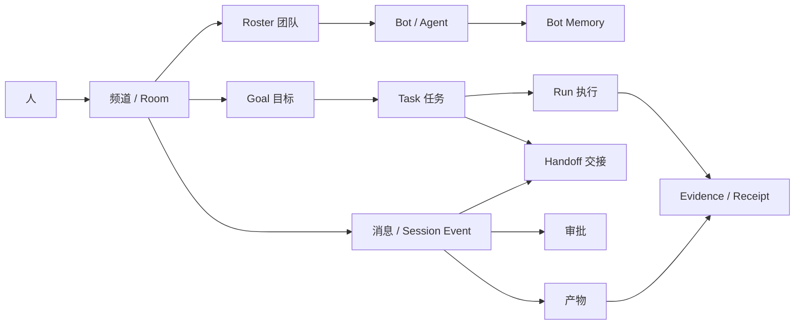
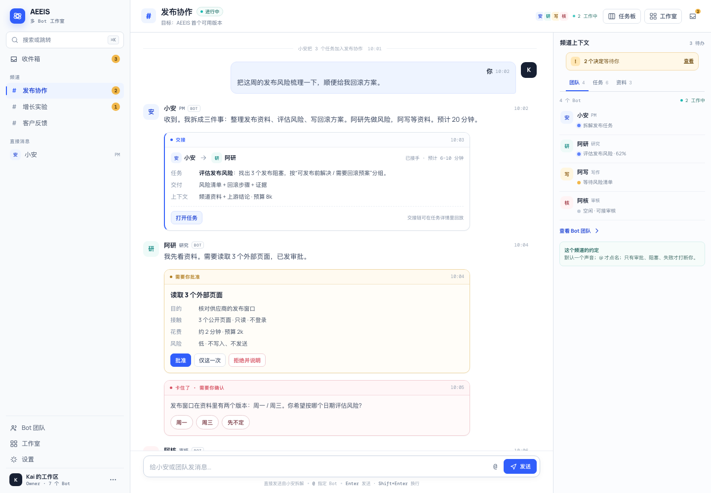

# AEEIS 多 Bot 团队交互设计

> **v2 修订说明**：上一版把 AEEIS 设计成以 Run 为中心的单 Agent 控制台，方向不对。本版改为 Grok Bot 式多 Bot 团队交互：**项目 = 频道，频道内有 Bot 名册、消息流、任务板和可见交接；人只在需要时出现。**
> 旧稿里的审批、证据、权限、可访问性内容被保留并重构；「控制室」不再是主界面，而是任务卡片背后的执行详情。

---

## 0. 一页摘要

### 0.1 设计命题

AEEIS 不是「一个 Agent 的控制台」，而是一间**多 Bot 工作室**：

> 你给一个常驻的 front-door Bot（默认入口 Bot）发消息，它把工作分给频道里的专家 Bot；Bot 之间互相交接，你在频道里看见过程，只在需要决定时被叫到。

> 可交互原型见 [`demo/index.html`](demo/index.html)，走查说明见 §22。

用户在 AEEIS 里只做四件事：

1. **派活**：像给同事发消息一样说出要推进的事。
2. **看进展**：谁在做、做到哪、卡在哪。
3. **做决定**：批准、回答、核查、验收。
4. **带团队**：加 Bot、改权限、教方法、复盘。

### 0.2 三条交互承诺

| 承诺 | 用户感知 | 界面证据 |
|---|---|---|
| 像同事一样说话 | 不需要先建 workflow、选模型、画 DAG | 一个输入框；front-door 自动拆解和分派 |
| 看得见谁在做什么 | 知道每个 Bot 的职责、状态、当前任务 | roster、任务板、交接卡、工作室视图 |
| 只在需要时打断 | 正常进展安静，只有决定才找人 | 收件箱只收 5 类事件；默认不弹窗、不逐条通知 |

### 0.3 八个设计决策

| ID | 决策 | 替代方案 | 影响 |
|---|---|---|---|
| D1 | **频道是主界面**：一个项目一个频道，频道内有目标、团队、消息流、任务板 | 以 Run / 仪表盘为主界面 | 新壳层；Room 升级为频道 |
| D2 | **Front-door Bot 是默认入口**：工作区一个总入口，每个频道一个 PM Bot（可由同一个 Bot 兼任） | 用户直接面对所有 Bot | 需要路由与汇总逻辑 |
| D3 | **Roster 常驻**：右侧展示每个 Bot 的角色、状态、当前任务 | 只在设置里管理 Bot | 需要 Bot 状态聚合 |
| D4 | **交接是一等消息**：Handoff 卡出现在消息流里，可点开、可追踪 | 只写系统日志 | 需要 delegation 事件可视化 |
| D5 | **默认一个声音，并行可见但不刷屏**：同一线程同一时刻只有一个 Bot 在说话；并行工作用状态条表达 | 所有 Bot 同时回复 | 需要发言权与节流规则 |
| D6 | **只在 5 类事件打断**：审批、提问/阻塞、结果不明、失败、直接 @ | 每个任务完成都通知 | 需要注意力分级 |
| D7 | **Bot 有名字、职责、边界、scoped memory** | 匿名工具调用 | 需要 Bot 档案与权限模型 |
| D8 | **工作室是可选视图**，不是独立产品 | 把动画办公室当主界面 | 同一事实源的空间化呈现 |

### 0.4 成功标准（首版假设）

- 用户发出第一条消息到收到第一个 Bot 回复：p50 **< 30 秒**。
- 一个任务从创建到完成的人工介入次数：**< 0.5 次/任务**。
- 每个任务的 Bot 消息数（噪声）：**< 6 条**。
- 交接深度：p50 **1–2 跳**，超过 5 跳强制回到 PM 或人。
- S1 待处理项 p90 年龄：**< 4 小时**。
- 频道内“需要你”的误报率：**< 10%**。

---

## 1. 为什么改成多 Bot

### 1.1 从 Grok Bot 学到的六个模式

参考 [Grok Bot 产品页](https://x.ai/bot)、[多团队实践](https://x.ai/bot/guides/how-i-run-multiple-teams-of-grok-bots)、[Bot Boss 实践](https://x.ai/bot/guides/grok-bot-for-work)、[PM 实践](https://x.ai/bot/guides/grok-bot-for-pms)：

1. **Message Bots like teammates**：不要求用户先搭 workflow；发消息就是派活。
2. **一项目一频道一 roster**：项目有频道、成员、任务板；PM Bot 做协调。
3. **Single front door**：Bot Boss / Chief of Staff 汇总专家汇报，用户不必追着每个 Bot 问。
4. **Connect the Bots**：同一线程里的 Bot 互相交接，用户看它们行动，而不是逐步批准。
5. **Named agents, scoped memory**：每个 Bot 有名字、职责、独立记忆；可引用、可并行、可追责。
6. **Quiet on noop**：没有变化就不说话；只在需要人时出现。

社区项目 [Bot 协作室](https://github.com/Olivia295/grokbot-teamwork-UI) 额外验证了“工作室”视图的价值：房间、工位、交接动画、关系网、时间线回放，让“谁把活交给了谁”一眼可见。但它是**只读可视化**，不是工作主界面。

### 1.2 AEEIS 对象如何映射

不新增领域对象；Bot 是 Agent 的产品化呈现，频道是 Room 的产品化呈现。

| Grok Bot 概念 | AEEIS 对应 | 说明 |
|---|---|---|
| Channel | Room | 长期协作边界，可绑定多个 Goal |
| Bot | Agent 身份 + Room membership + scoped memory | 不新增实体；增加 UI 档案与状态 |
| Front-door / PM Bot | Orchestrator Agent（Room 内 `agent` 角色） | 负责拆解、分派、汇总 |
| Roster | Room 的 agent 成员 + 已准入外部 Agent | 需要状态与角色展示 |
| Task board | Plan 节点 / 领域 Task | 复用 DAG 与 Task 状态机 |
| Handoff | Delegation / Task assignment | 复用事件与回执 |
| Thread / message | Session Event（`message` / `canonical_response` / `decision` / `task_update`） | 复用 append-only 事件流 |
| Needs you | Attention | 复用待处理判定，收窄到 5 类 |
| Studio | 同一事件流的空间化视图 | 只读派生，不成为事实源 |
| Memory | Goal Memory / Bot Memory | 需要按 Bot 分域 |
| Approval | 现有治理门 | 保持审批与审计 |

### 1.3 上一版为什么不对

| 问题 | 上一版的做法 | 多 Bot 模式的要求 |
|---|---|---|
| 中心错了 | 以 Run 详情为首页 | 以频道和团队为首页；Run 是卡片背后的执行 |
| 只有一个人格 | 一个 Agent 从头到尾 | 多个有名字、职责、记忆的 Bot 协作 |
| 看不见协作 | 只有时间线和事件 | 交接卡、roster、任务板、关系网 |
| 用户在操作面板 | 审批、配置、图表堆在一起 | 用户在对话；配置退到 Bot 档案与设置 |
| 打断太多 | 每个状态变化都进详情 | 只有需要决定时才找人 |
| 单线程 | 一次一个 Run | 多任务并行、多个 Bot 同时工作 |

### 1.4 不照搬 Grok Bot 的地方

- **Bot 不是黑盒**：每个结论必须能回到来源、回执或产物；无证据时标记 `未验证`。
- **审批不能省**：外部发送、购买、删除、授权新 Bot、跨租户访问必须有人批准。
- **租户与权限是一等边界**：频道、Bot、记忆、证据都按 owner/tenant 隔离。
- **可回放、可审计**：交接链、审批、记忆变更都留痕，不因“像同事”而变得不可解释。

---

## 2. 用户与任务

### 2.1 角色

| 角色 | 在频道里是谁 | 主要动作 | 最怕什么 |
|---|---|---|---|
| Owner | 项目负责人 | 派活、批准、验收、加 Bot | Bot 乱花钱 / 乱发消息 / 结论无证据 |
| Editor | 协作者 | 补充资料、改任务、@Bot | 越权；看到过期结论 |
| Viewer | 观察者 | 看进展、读交付 | 被大量 Bot 消息淹没 |
| Operator | 运维 / 治理者 | 管权限、模型、预算、RSI | 无法回滚；审计断链 |
| Bot | 团队成员 | 接任务、交接、提问、交付 | 职责不清；重复劳动；死循环 |

### 2.2 核心任务

| Job | 用户原话 | 期望 |
|---|---|---|
| J1 派活 | “把这周的发布风险梳理一下，顺便给我回滚方案。” | 不配置，直接得到一个任务和负责人 |
| J2 看进展 | “现在谁在做什么？” | roster + 任务板一眼看懂 |
| J3 被叫到 | “需要我批什么？” | 收件箱只列真正需要决定的事 |
| J4 验收 | “这个结论可信吗？” | 交付卡 + 证据 + 审核意见 |
| J5 带团队 | “以后发布风险都按这个格式。” | 记住偏好，下次自动执行 |
| J6 复盘 | “这周团队干了什么？” | 日报 + 交接链 + 阻塞时长 |

---

## 3. 交互原则

| 原则 | 含义 | 具体规则 | 反模式 |
|---|---|---|---|
| P1 先对话，后配置 | 用户不需要先搭 workflow | 默认输入框就是派活；配置收进 Bot 档案与设置 | 一进来就要求选模型、画 DAG、填 JSON |
| P2 一频道一项目一团队 | 频道是注意力的容器 | 频道有目标、roster、任务板；跨项目不混在一个流里 | 所有 Bot 在一个大群刷屏 |
| P3 默认一个声音 | 同一线程同时只有一个 Bot 在说话 | 其他 Bot 用“正在工作”状态表达；完成后由 owner Bot 汇总 | 三个 Bot 同时回复同一句话 |
| P4 交接可见 | 谁把什么交给了谁必须能看见 | Handoff 卡 + 任务链接 + 回放 | 只在日志里写 delegation |
| P5 只在需要时打断 | 进度不打扰，决定才打扰 | 仅 5 类事件进收件箱；其余进摘要 | 每完成一步弹 toast |
| P6 Bot 有身份 | 名字、职责、边界、记忆 | 消息签名、Bot 档案、权限表 | 匿名“助手” |
| P7 证据跟着结论走 | 结论旁边就是证据 | 每个主张有 `[S1]`；无证据标 `未验证` | 只给一段漂亮文字 |
| P8 人的判断在边界上 | 授权、花钱、外发、删除必须人批 | 审批卡 + 后果预览 + 必填原因 | 让 Bot 自行决定外发 |
| P9 工作室是视图 | 空间化不是事实源 | 从事件派生；列表/表格可替代 | 把动画当主界面 |

---

## 4. 信息架构

### 4.1 对象关系



### 4.2 五个界面

| 界面 | 回答的问题 | 主要内容 | 入口 |
|---|---|---|---|
| **频道** | 这个项目现在怎么样？谁在做什么？ | 消息流、roster、任务板、频道目标 | 左侧频道列表；默认页 |
| **收件箱** | 有什么事需要我？ | 审批、提问、阻塞、结果不明、失败 | 左侧固定项 + 徽标 |
| **Bot 团队** | 我有哪些 Bot？各自能做什么？ | Bot 目录、档案、权限、记忆 | 左侧“Bot 团队” |
| **工作室** | 团队是怎么协作的？ | 空间、关系网、时间线、回放 | 频道头切换；可选 |
| **设置 / 治理** | 系统被允许做什么？ | 模型、工具、预算、RSI、审计 | 左下角 |

> “运行历史”“证据图”“时间线”不再是顶层工作面，而是任务卡、交接卡、产物卡背后的详情抽屉。

直接消息是只有你和某个 Bot 的频道，复用同一消息模型；不单独做一套 DM 界面。工作区总入口就是你和 front-door 的直接消息。

### 4.3 布局

```text
┌──────────────┬────────────────────────────────────────────┬──────────────────┐
│ 左侧栏 260   │ 频道主区 fluid                              │ 右栏 300         │
│ 频道 / 收件箱│ 频道头 + 消息流 + 输入框                    │ 团队 / 任务 / 资料│
└──────────────┴────────────────────────────────────────────┴──────────────────┘
```

- 左栏：工作区切换、搜索（`⌘K`）、收件箱、频道列表、直接消息、Bot 团队、工作室、设置。
- 主区：频道头（名称、目标、状态、成员头像、任务板/工作室切换）→ 消息流 → 输入框。
- 右栏：三个 tab——`团队`（roster）、`任务`（board）、`资料`（来源、文件、证据）。
- 工作室模式替换主区 + 右栏；左栏保留。
- 频道内任务详情、Bot 档案、证据都以右侧抽屉或覆盖层打开，不离开频道。
- `⌘K` 搜索覆盖频道、任务、Bot、消息、证据；结果分组，`Enter` 跳转。

### 4.4 路由

```text
/c/<channelId>                    频道
/c/<channelId>/t/<threadId>       线程
/c/<channelId>/tasks/<taskId>     任务详情
/c/<channelId>/studio             工作室
/inbox                            收件箱
/bots                              Bot 团队
/bots/<botId>                      Bot 档案
/settings                          设置
```

规则：

- 刷新后回到同一频道、同一线程、同一抽屉。
- 频道内切换任务不整页刷新。
- 权限不足保留 URL，说明角色与申请路径。

### 4.5 响应式

| 宽度 | 布局 |
|---|---|
| ≥ 1280 | 左栏 260 / 主区 fluid / 右栏 300 |
| 960–1279 | 左栏 240 / 主区 fluid；右栏收为抽屉 |
| 640–959 | 单栏；频道列表变抽屉；任务板横向滚动 |
| < 640 | 单栏；输入框固定底部；审批全屏；工作室不可用 |

---

## 5. 频道与消息

### 5.1 频道结构

```text
┌ # 发布协作 ─────────────────────────── 进行中 · 6 个任务 · 2 需要你 ┐
│ 目标：AEEIS 首个可用版本          [任务板] [工作室] [频道设置]      │
├──────────────────────────────────────────────────────────────────────┤
│ 小安  PM · 10:02                                                     │
│ 收到。我拆成三件事：整理发布资料、评估风险、写回滚方案。              │
│ 阿研先做风险，阿写等资料。                                            │
│                                                                      │
│ ┌ 交接 · 小安 → 阿研 ─────────────────────────────────────────────┐ │
│ │ 任务   评估发布风险，给出回滚方案                                │ │
│ │ 上下文 4 个来源 · 预算 8k · 预计 6–10 分钟                       │ │
│ │ [打开任务]                                                       │ │
│ └──────────────────────────────────────────────────────────────────┘ │
│                                                                      │
│ 阿研  研究 · 10:04                                                   │
│ 我先看资料。需要读取 3 个外部页面，已发审批。                         │
│ ┌ 审批 ────────────────────────────────────────────────────────────┐ │
│ │ 读取 3 个公开页面 · 只读 · 约 2 分钟 · 预算 2k                   │ │
│ │ [批准]  [仅这一次]  [拒绝并说明]                                 │ │
│ └──────────────────────────────────────────────────────────────────┘ │
│                                                                      │
│ 你  10:06                                                            │
│ 批准，注意只看公开页面。                                              │
│                                                                      │
│ 阿研 正在输入…                                                        │
├──────────────────────────────────────────────────────────────────────┤
│ 给小安或团队发消息…                          @ 提及   📎   发送       │
└──────────────────────────────────────────────────────────────────────┘
```

### 5.2 消息类型

| 类型 | 出现方式 | 作用 | 可展开 |
|---|---|---|---|
| `human_message` | 头像 + 名字 + 时间 | 派活、回答、讨论 | 编辑 / 引用 / 转任务 |
| `bot_message` | Bot 头像 + 名字 + 角色 + “Bot” | 回复、汇报、提问 | 引用 / 查看依据 |
| `handoff` | 卡片 | 交接任务与上下文 | 任务、起点、接收方、预算 |
| `task_update` | 紧凑行或卡片的阶段更新 | 领取、开始、完成等无需人介入的进展 | 任务详情 |
| `approval_request` | 琥珀色卡片 | 请求授权 | 审批单 |
| `question` | 卡片 + 选项 | 需要人补充信息 | 回答后继续 |
| `blocked` | 红色卡片 | 任务卡住 | 原因、依赖、可选动作 |
| `artifact` | 产物卡片 | 交付结果 | 全文、证据、审核 |
| `memory_update` | 折叠行 | Bot 学到了什么 | 记忆详情、修正 |
| `digest` | 摘要卡 | 批量进展 | 展开完整列表 |
| `system` | 灰色折叠行 | 状态、错误、连接 | 原始数据 |

规则：

- 一张卡片只承载一件事；不要把审批、任务、证据塞进同一条消息。
- 系统事件不进入主视觉；默认折叠，`⌘/` 或“查看记录”展开。
- Bot 消息必须签名（名字 + 角色 + Bot 标识），不允许匿名。

### 5.3 谁回复：路由规则

| 用户动作 | 默认行为 | 例外 |
|---|---|---|
| 直接发消息（无 @） | 留在群的时间线里；front-door 收下并记成一条讨论 | 私聊单独保留，只有 @AEEIS 才记入入口 |
| `@Bot` | 留在群里。front-door 收下。在群里的那位再记一条「请回应」 | 点名的人不在这个群里时，只由 front-door 收下 |
| `@团队` | 留在群里；front-door 记成一条，不拆开 | 讨论只记账，不执行 |
| 线程内回复 | 线程参与者继续；不广播到频道 | 需要全员知道时，front-door 提升为频道消息 |
| 点击任务“转交” | 打开 roster，选择接收方；生成 handoff 卡 | 接收方拒绝 → 回到原 owner，原因可见 |
| 人类直接改任务 | 记录为人类操作；通知 owner Bot | 权限不足 → 只读并说明 |

发言权规则：

- 同一线程同一时刻只有一个 Bot 在“说话”；其他 Bot 用状态条表达“正在工作”。
- 多个 Bot 需要同时汇报时，由 front-door 汇总成一条 digest，或各自在线程内回复（仅在用户明确要求“各自说”时）。
- Bot 之间的讨论放进侧线程。侧线程是它们的私聊，不进群。点开某个 Bot 的单独对话时，能看到它和其他 Bot 的私聊，默认折叠。

### 5.4 防噪规则

多 Bot 产品最大的失败模式不是“不够智能”，而是“太吵”。硬规则：

1. **Quiet on noop**：没有状态变化、没有新结论、没有需要人做的事，不发消息。
2. **里程碑而非每一步**：任务只在领取、50%、阻塞、完成、失败时更新；中间步骤进详情。
3. **一个声音**：默认由 front-door 或任务 owner 汇总；专家不抢话。
4. **批量摘要**：非紧急进展每 15–30 分钟合并成一条 digest；用户可调频率。
5. **速率限制**：每个频道每 10 分钟最多 6 条 Bot 主动消息；超出进入 digest。
6. **安静时段**：可配置；非紧急消息不推送，只在收件箱累积。
7. **不制造紧迫感**：禁止“紧急”“立刻”除非有明确的外部截止时间或用户设置。

频道级开关：`安静`（默认，一个声音）/ `热闹`（允许 Bot 互相接话，仍受速率限制）。

### 5.5 交接卡（Handoff）

```text
┌ 交接 · 小安 → 阿研 ─────────────────────────── 10:03 ┐
│ 任务   评估发布风险，给出回滚方案                      │
│ 交付   风险清单 + 回滚步骤 + 证据                      │
│ 上下文 4 个来源 · 1 个已批准工具 · 预算 8k             │
│ 状态   已接手 · 预计 6–10 分钟                         │
│ [打开任务]  [查看上下文]                               │
└────────────────────────────────────────────────────────┘
```

规则：

- 交接必须包含：任务、期望交付、上下文摘要、预算、接收方。
- 接收方可以接受或拒绝；拒绝必须给原因，任务回到发送方或 PM。
- 交接生成/更新任务卡；任务卡是唯一事实源，卡片只是入口。
- 交接深度上限 5；超过后强制回到 PM 或人，避免踢皮球。
- 同一任务不能被两个 Bot 同时持有；冲突时先声明者获胜，另一个看到“已被领取”。

### 5.6 任务卡

```text
┌ 任务 · 评估发布风险 ─────────────── 进行中 · 阿研 ┐
│ 目标  找出 3 个发布阻塞并给出回滚方案              │
│ 依赖  发布资料（已就绪）                           │
│ 产出  风险清单 · 回滚步骤 · 证据 4                 │
│ [详情]  [转交]  [标记阻塞]                         │
└────────────────────────────────────────────────────┘
```

任务卡出现在频道流和任务板中，字段一致：

- 标题、目标、owner、状态、依赖、产出、证据数、预算、年龄。
- 点击打开任务详情抽屉；不跳页。
- 卡片上的操作与任务详情一致，不出现“卡片能点、详情不能点”的分裂。

### 5.7 审批、提问、阻塞、失败

**审批卡**：

```text
┌ 需要你批准 ───────────────────────────── 阿研 · 2 分钟前 ┐
│ 动作  读取 3 个外部页面（公开文档）                        │
│ 原因  核对供应商的发布窗口                                │
│ 影响  只读 · 不写入 · 约 2 分钟 · 预算 2k                 │
│ [批准]  [仅这一次]  [拒绝并说明]                          │
└────────────────────────────────────────────────────────────┘
```

**提问卡**：

```text
┌ 卡住了 · 需要你确认 ─────────────────── 阿研 · 8 分钟 ┐
│ 发布窗口在资料里有两个版本：周一 / 周三。                │
│ 你希望按哪个日期评估风险？                               │
│ [周一]  [周三]  [其他…]                                  │
└──────────────────────────────────────────────────────────┘
```

**阻塞卡**：依赖缺失、权限不足、外部回执不明。必须写“卡在哪、需要谁、你能做什么”。

**失败卡**：发生在哪个任务、原因、影响、已保留的事实；动作：重试、改派、重新规划、取消。有未核查外部副作用时，先核查，禁止直接重试。

### 5.8 消息操作

| 操作 | 人类消息 | Bot 消息 | 说明 |
|---|---|---|---|
| 回复线程 | ✓ | ✓ | 不打断主频道 |
| 引用 | ✓ | ✓ | 引用片段进入输入框 |
| 转任务 | ✓ | ✓ | 从消息创建任务卡 |
| 复制 | ✓ | ✓ | 保留发送者与时间 |
| 查看依据 | — | ✓ | 打开证据抽屉 |
| 编辑 | 5 分钟内 | — | 显示“已编辑” |
| 撤回 | 5 分钟内 | — | 显示“已撤回”，不删除审计 |
| 置顶 | ✓ | ✓ | 频道级，最多 3 条 |
| 反应 | ✓ | — | 只用于轻确认，不代替回答 |

### 5.9 修订与撤回

- Bot 消息 append-only；需要更正时发送新消息并引用旧消息，旧消息标记“已被更正”。
- 人类消息 5 分钟内可编辑；超过后只能追加更正。
- Room 的 `canonical_response` 修订/撤回继续追加事件，不在 UI 上原地改写；时间线保留历史。
- 删除频道不删除审计；归档后只读。

### 5.10 侧线程（Bot 之间的私聊）

侧线程是 Bot 和 Bot 之间的私聊，不出现在群里。群聊保留给所有人和所有 Bot 都能看见、都能追溯的内容。

点开某个 Bot 的单独对话时，能看到它和其他 Bot 的私聊，默认折叠。展开后才读那一段来回。需要人决定的事仍回到群或收件箱，不靠把私聊刷进群。

---

## 6. Roster 与 Bot

### 6.1 Roster

```text
团队 4                                     [邀请 Bot]
● 小安   PM      正在拆任务
● 阿研   研究    执行中 · 62%
● 阿写   写作    等待依赖
○ 阿核   审核    空闲
```

- 排序：需要你 > 执行中 > 等待 > 空闲 > 离线。
- 每个 Bot 显示：头像、名字、角色、状态、当前任务（最多一行）。
- 点击打开 Bot 档案抽屉。
- 顶部显示“N 个 Bot 在工作中”；这是频道头的状态来源。
- 不显示“最后在线 3 分钟前”这类噪声；只在离线/异常时显示。

### 6.2 Bot 档案

```text
┌ 阿研 · 研究 Bot ─────────────────────── 在线 · 执行中 ┐
│ 职责  资料检索、竞品与风险分析                          │
│ 当前  评估发布风险 · 已运行 4 分钟                      │
│ 记忆  供应商只签年付 · 发布窗口偏好周三                 │
│ 权限  只读资料、浏览器只读、预算 20k/任务               │
│ 最近  交接给阿写 2 次 · 平均 6 分钟                     │
│ [暂停]  [调整权限]  [查看全部任务]                      │
└──────────────────────────────────────────────────────────┘
```

档案必须包含：

1. 名字、头像、角色、一句话职责。
2. 状态与当前任务。
3. 能力：技能、工具、数据源。
4. 权限：能读什么、能调用什么、能否外发、预算。
5. 记忆：它记住的事实与偏好；可修正、可删除（需原因）。
6. 最近活动：任务、交接、审批、失败。
7. 设置：模型、节奏、通知、是否允许主动发言。

### 6.3 组队规则

新建频道：输入名称与目标 → front-door 提议 roster（优先复用；默认最多 10 人，含 PM，创建时可改成 2 到 30）→ 人确认 → 频道创建，front-door 发第一条消息说明分工。

- 需要新 Bot 时，先说明“为什么现有 Bot 不够”，经人批准后创建。
- Bot 可加入多个频道；记忆按 Bot 分域，频道上下文按频道隔离。
- 移除 Bot 前检查它持有的任务：转交或退回“待领取”，不能直接消失。
- 归档频道时，所有 Bot 停止接新任务；在途任务可选择完成或取消。

Front-door 与 PM 可以是同一个 Bot：工作区总入口是它的直接消息，频道里它是 PM。首版建议同一个身份，避免用户记两套名字；频道多、负载高时再拆成独立 PM。

### 6.4 Bot 状态

| 状态 | 徽标 | 含义 | 频道表现 |
|---|---|---|---|
| `idle` | 空闲 | 没有任务 | 灰点，排在后面 |
| `working` | 执行中 | 正在执行任务 | 蓝点 + 当前任务一行 |
| `waiting` | 等待 | 等依赖、等外部回执 | 琥珀点 + 等什么 |
| `blocked` | 需要你 | 等人回答/批准/核查 | 红点 + 收件箱 |
| `paused` | 已暂停 | 被人为暂停 | 灰点 + 原因 |
| `offline` | 离线 | 不可用 | 空心点 + 最后在线 |

### 6.5 身份与语气

- Bot 有名字、头像、角色签名；消息旁必须标 `Bot`。
- 不允许 Bot 冒充人类；不允许使用“我作为一个人”这类表述。
- Bot 的语气可配置（简洁 / 详细 / 正式 / 轻松），但必须遵守事实边界。
- 头像与颜色只是识别，不承载状态；状态用点和文字。
- 同一 Bot 在不同频道保持同一身份，但频道内可以有不同的职责说明。

### 6.6 Scoped memory

- 每个 Bot 只记住与职责相关的事实；front-door 记住用户偏好与团队规则。
- 记忆以卡片/芯片展示：“已记住：供应商只签年付”。
- 写入记忆需要来源（对话、文件、审批），并标隐私级别。
- 人可以修正、撤回、删除；删除需原因，保留审计。
- 频道记忆与 Bot 记忆分开：频道共享事实，Bot 保留个人工作记忆。
- 记忆不得跨租户；跨频道引用需显式授权。

### 6.7 权限

| 能力 | 默认 | 可授予 | 审批 |
|---|---|---|---|
| 读频道资料 | ✓ | — | 否 |
| 读外部网页 | — | 浏览器只读 | 首次 / 每次可选 |
| 调用注册工具 | — | 按工具 | 首次 / 按次 |
| 写入外部系统 | — | 明确白名单 | 每次或按任务 |
| 发送消息给人 | — | 草稿 / 代发 | 代发必须批 |
| 花费预算 | 限额 | 按任务/频道 | 超限必须批 |
| 创建新 Bot | — | PM 可提议 | 人批准 |
| 写 Bot 记忆 | ✓（自己的） | — | 敏感记忆需批 |
| 读其他 Bot 记忆 | — | 显式共享 | 人批准 |

外部 Agent 以 Bot 身份加入时，档案必须标来源、准入范围与有效期；默认只读，外发/写入需审批。

### 6.8 Bot 团队目录

工作区级的“Bot 团队”页，用于跨频道管理，不替代频道 roster。

- 卡片：头像、名字、角色、所在频道、状态、最近任务。
- 筛选：角色、状态、频道、是否外部 Agent。
- 操作：邀请到频道、暂停、调整权限、查看档案。
- “新建 Bot”走模板 + 审批；不允许空白人格直接上线。
- 外部 Agent 显示来源、准入范围与到期时间。

---

## 7. 任务板与执行

### 7.1 任务板

```text
待整理 2        待领取 1        进行中 3        阻塞 1        待验收 1
┌────────┐     ┌────────┐     ┌────────┐     ┌────────┐     ┌────────┐
│发布资料 │     │竞品对比 │     │风险评估 │     │回滚演练 │     │周报    │
│无 owner │     │待认领   │     │阿研 62%│     │等权限   │     │阿写    │
└────────┘     └────────┘     └────────┘     └────────┘     └────────┘
```

列：

1. **待整理**：从消息/会议/提醒捕获，尚未定义目标。
2. **待领取**：已定义，等 owner；Bot 可按角色认领。
3. **进行中**：有 owner，正在执行或等待外部。
4. **阻塞**：缺信息、缺权限、外部不确定；其中需要你处理的部分进收件箱。
5. **待验收**：有产物，等人确认。
6. **完成**：已验收或自动通过。

失败任务默认收进看板顶部的“失败”筛选条，不单独占列；处理后重试、改派或取消。

阻塞分两种：`等外部`（不催人，超过阈值才升级）与 `需要你`（进收件箱）。同一列，卡片副标题区分。

规则：

- 卡片是任务的事实源；消息流中的任务卡与看板同步。
- 每列有 WIP 上限（默认进行中 3/人）；超限提示先完成或转交。
- 拖动改状态必须合法；非法拖动给出原因，不静默回弹。
- 任务年龄超过 24 小时显示“已停留 1 天”；阻塞超过 4 小时升级。

### 7.2 领取与分派

- **PM 分派**：front-door 根据角色、负载、权限选择 owner。
- **Bot 认领**：只能认领 `ready` 且角色匹配的任务；先到先得。
- **人指派**：从 roster 选择；被指派 Bot 可拒绝并说明（例如权限不足）。
- **冲突**：两个 Bot 同时认领，第一个成功；第二个看到“已被领取”，可加入协作或换任务。
- **负载**：每个 Bot 同时最多 2 个进行中任务；超出时 PM 不应再分派。

### 7.3 依赖与并行

- 任务卡显示 `依赖 2`；依赖未完成时不能进入 `进行中`。
- 可并行的任务在频道头显示“3 个 Bot 并行工作中”。
- 并行不等于同时说话：执行状态进 roster/看板，消息仍按 §5.4 节流。
- 依赖失败时，下游任务自动进入 `阻塞`，并通知 owner 与 PM。

### 7.4 任务详情

```text
┌ 任务 · 评估发布风险 ────────────────────────────── 进行中 ┐
│ 目标   找出 3 个发布阻塞并给出回滚方案                      │
│ Owner  阿研 · 预算 8k · 已用 3.2k                          │
│ 依赖   发布资料（已完成）                                   │
│ 执行   Run run_01J… · 复核中                                │
│ 证据   4 个来源 · 2 个回执 · 1 个产物                       │
│ 交接   小安 → 阿研（10:03）                                 │
│ [打开执行详情]  [转交]  [阻塞]  [取消]                      │
└─────────────────────────────────────────────────────────────┘
```

- 执行详情是任务背后的抽屉，复用 Run 的状态机、审批、证据、时间线。
- 频道里不直接展示事件日志；需要时打开“记录”。
- 任务详情必须能回答：谁在做、为什么停、花了多少、产出什么、证据在哪。

### 7.5 交付与验收

产物卡：

```text
┌ 产物 · 发布风险与回滚方案 ───────────── 阿研 · 10:12 ┐
│ 结论  3 个阻塞，2 个可在发布前解决，1 个需要回滚预案   │
│ 证据  [S1] 发布清单  [S2] 供应商邮件  [S3] 变更记录   │
│ 审核  阿核：通过 · 置信度 82%                          │
│ [阅读全文]  [验收]  [要求修改]  [保存到记忆]           │
└────────────────────────────────────────────────────────┘
```

- 产物卡先给结论，再给证据；全文在抽屉。
- 未验收的产物不能自动进入下游任务；需要人工验收或明确的自动通过规则。
- “要求修改”创建一个新的修订任务，不覆盖旧产物。
- “保存到记忆”绑定证据与来源；不得降低隐私级别。

### 7.6 工作台与接管

- 每个执行中的任务有一个“工作台”抽屉：当前步骤、工具调用、截图/回执、耗时、花费。
- 人可以“接管”：暂停 Bot，接管浏览器/工具会话；Bot 进入 `paused`，频道说明“人已接管”。
- 交还时写一句交接说明；Bot 继续，不丢上下文。
- 接管不绕过审批；人在工作台里的外发、购买仍按权限走。
- 工作台默认只读；接管是显式动作，需确认。
- 首版工作台是当前 Run 的可视化；持久云桌面是后续能力，不在本期承诺。

---

## 8. 关键时刻

### 8.1 派活

```text
你：把这周的发布风险梳理一下，顺便给我回滚方案。
  ↓
小安（PM）：收到。我拆成三件事：整理发布资料、评估风险、写回滚方案。
            阿研先做风险，阿写等资料。预计 20 分钟。
  ↓
[任务卡 × 3] + [交接卡 小安 → 阿研]
```

规则：

- 默认不要求用户确认拆解；低风险任务直接开始。
- 如果涉及外部写入、购买、删除、跨租户，先发审批卡，不先执行。
- 拆解超过 6 个任务时，先给用户一个摘要和“开始 / 调整”选择，避免一口气铺开。
- 用户说“别拆这么细”或“只要结论”时，写入频道偏好。

### 8.2 审批

- 审批卡内联在消息流；点击“批准”直接生效，点击卡片打开审批单看详情。
- “批准”= 本任务内有效，同类动作不再逐次询问；“仅这一次”= 只执行当前动作，不记忆。
- 审批单六块：要做什么、为什么、接触什么、花多少、风险、如何撤回。
- 高风险（外发、购买、删除、授权）要求选择原因或输入确认，不用二次“确定吗”弹窗。
- 审批结果回到频道，Bot 继续；拒绝必须给原因，Bot 可重新规划。
- 审批人不在线时，front-door 可以汇总等待，不重复催。

### 8.3 提问与阻塞

- Bot 提问必须具体、可回答、带默认选项；禁止“请提供更多信息”。
- 问题卡只有一个问题；多个问题拆成多条或一张带编号的卡。
- 回答后任务自动恢复；如果回答不足以解除阻塞，Bot 说明还缺什么。
- 阻塞超过 4 小时，收件箱升级；超过 24 小时，PM 提议改派或取消。

### 8.4 结果不明（unknown）

- Bot 不自动重试有外部副作用的调用。
- 卡片写清：调用了什么、已知什么、不知道什么、为什么停下。
- 人选择：已完成 / 未完成 / 部分完成 + 证据；Bot 据此恢复或失败。
- 核查结果进入审计，不覆盖原始回执。

### 8.5 失败与改派

- 失败卡：发生在哪、原因、影响、保留了什么、建议。
- 动作：重试（无副作用时）、改派（换 Bot）、重新规划（换方案）、取消。
- 同一任务连续失败 2 次，PM 必须介入，不允许第三个 Bot 静默重试。

### 8.6 验收

- 产物卡给结论、证据、审核意见。
- 验收人可以是 owner、editor 或指定的审核 Bot；权限按频道角色。
- 验收通过后，任务进入 `完成`，下游自动解锁。
- 要求修改时，写清修改点；新产物引用旧产物，不覆盖。

### 8.7 带教

- “看着我做一个流程” → Bot 记录步骤、工具、判断点，生成 routine 草案。
- 用户确认后，routine 进入 Bot 档案；下一次由 Bot 执行，关键步骤仍可设审批。
- 教一次只影响该 Bot / 该频道，不自动扩散到全工作区。
- 教学记录可回放、可撤销。

### 8.8 复盘

- 每日/每周 digest：完成、阻塞、交接、耗时、花费、需要你。
- 关系网：谁和谁交接最多；异常单向依赖。
- 时间线回放：一次任务从开口到交付经过哪些 Bot。
- 复盘结论可以变成团队规则（例如“发布风险必须先查变更记录”）。

### 8.9 Bot 升级（RSI）

- Bot 的提示词、工具、模型升级以卡片进入频道，不静默替换。
- 卡片写明：改什么、为什么、证据（影子/金丝雀结果）、影响哪些频道。
- 动作：批准、拒绝、先影子运行、回滚。
- 只对 Owner/Operator 展示完整卡片；普通成员看到“团队升级”摘要。
- 升级期间，正在执行的任务不中断；新任务使用新版本。

---

## 9. 收件箱（Needs You）

### 9.1 收什么

| 类型 | 来源 | 严重级 |
|---|---|---|
| 审批请求 | 工具、外发、购买、授权 | S1 |
| 提问 / 阻塞 | 任务缺信息、缺权限 | S1 |
| 结果不明 | 外部调用 unknown | S2 |
| 失败 | 任务失败、投影失败 | S3 |
| 直接 @ | 人明确点名 | S3 |

不收：普通任务完成、Bot 正常进展、系统心跳、未 @ 人的讨论。

### 9.2 排序与老化

1. 严重级 S1 → S3。
2. 同级按等待时间从长到短。
3. 同一频道相邻，但不合并不同决定。

| 严重级 | 正常 | 提醒 | 升级 |
|---|---|---|---|
| S1 | < 1 小时 | 1–4 小时 | > 4 小时 |
| S2 | < 2 小时 | 2–8 小时 | > 8 小时 |
| S3 | < 24 小时 | 24–72 小时 | > 72 小时 |

### 9.3 条目

```text
┌ ● 待批准 ───────────────────────────── 发布协作 · 2 分钟 ┐
│ 阿研请求读取 3 个外部页面                                 │
│ 只读 · 约 2 分钟 · 预算 2k                                │
│ [批准]  [查看]                                            │
└───────────────────────────────────────────────────────────┘
```

- 每条一个动作；动作与频道内一致。
- 失败项快捷动作是“查看原因”，不是直接重试。
- 打开不等于已处理；只有状态变化才移除。
- 空态：“没有需要你决定的事。团队会继续工作。”

### 9.4 通知

- 应用内：徽标 + 收件箱；默认不弹模态。
- 浏览器通知：默认关闭；只对 S1 开放。
- 移动端推送：只对 S1，可配置安静时段。
- 同一事件不重复通知；Bot 不催办。
- 用户正在输入时，延迟展示新收件项，不抢焦点。

---

## 10. 工作室视图

### 10.1 定位

工作室是**同一频道事实的空间化视图**：房间 = 频道，工位 = Bot，交接 = 走动与递信，状态 = 头顶图标。它用于：

- 站会/演示：一眼看出谁在忙、谁卡住。
- 调试：看清一次任务经过哪些 Bot、在哪一跳丢失。
- 复盘：关系网与时间线回放。

它不用于日常派活；日常仍在频道里。工作室只读，所有操作回到频道/任务详情。

### 10.2 三种视图

| 视图 | 表达 | 交互 |
|---|---|---|
| 工作室 | 房间、工位、休息区；Bot 走动交接 | 点 Bot 看档案；点交接看任务；回放 |
| 关系网 | 交接次数、方向、粗细 | 点边看最近一次交接；筛选频道/时间 |
| 时间线 | 每个 Bot 一行，彩色交接线 | 回放、暂停、单步、调速 |

### 10.3 线与状态

```text
┌ 工作室 · 发布协作 ─────────────────── 3 人在忙 · 1 空闲 ┐
│ ┌ 会议室 ──────────────┐  ┌ 工位区 ──────────────────┐ │
│ │ 小安  📋 在拆任务     │  │ 阿研 🖥 执行 · 62%        │ │
│ │                      │  │ 阿写 ✍ 等待依赖           │ │
│ └──────────────────────┘  │ 阿核 💤 空闲               │ │
│                           └───────────────────────────┘ │
│ 交接  小安 → 阿研  10:03  [回放]                         │
│ 需要你 2  [打开收件箱]                                   │
└──────────────────────────────────────────────────────────┘
```

- 状态图标：齿轮=执行中、对勾=完成、省略号=阅读/等待、信封=交接、感叹号=阻塞、z=空闲。
- 交接动画只在工作室出现；频道内用卡片，不用动画。
- 隐私模式隐藏消息内容，只保留“谁和谁在协作”。
- `prefers-reduced-motion` 下取消走动，改为高亮与连线。

### 10.4 可访问性

- 工作室必须有“列表/表格”替代视图；图不是唯一信息载体。
- 回放提供键盘控制（空格暂停、左右单步）。
- 颜色不单独承载状态；图标 + 文字。
- 移动端不提供工作室；提供“查看团队状态”列表。

---

## 11. 界面规格

### 11.1 频道桌面

```text
┌───────────────┬────────────────────────────────────────────┬──────────────────┐
│ AEEIS    ⌘K   │ # 发布协作          进行中 · 6 任务 · 2 需要你│ 团队 4           │
│               │ 目标 AEEIS 首个可用版本    [任务板] [工作室]│ ● 小安 PM 拆任务 │
│ 收件箱 2      │────────────────────────────────────────────│ ● 阿研 研究 执行 │
│               │ 小安 PM · 10:02                            │ ● 阿写 写作 等待 │
│ 频道          │ 收到。我拆成三件事…                        │ ○ 阿核 审核 空闲 │
│ # 发布协作    │ [交接 小安→阿研]                           │                  │
│ # 增长实验    │ 阿研 · 10:04 我先看资料，需要读取 3 个页面 │ 任务             │
│ # 客户反馈    │ [审批 读取 3 个页面]                       │ 待整理 1         │
│               │ 你 · 10:06 批准，注意只看公开页面          │ 进行中 3         │
│ 直接消息      │ 阿研 正在输入…                             │ 阻塞 1           │
│ 小安          │                                            │ 待验收 1         │
│               │                                            │                  │
│ 工作室        │                                            │ 资料 4 个来源    │
│ 设置          │                                            │ [查看全部]       │
│               ├────────────────────────────────────────────┤                  │
│               │ 给小安或团队发消息…        @ 提及  📎  发送│                  │
└───────────────┴────────────────────────────────────────────┴──────────────────┘
```

规格：

- 左栏 260px；频道项显示未读点、进行中数量、需要你数量（最多一个徽标）。
- 频道头 64px；目标一行，超出省略；成员头像最多 6 个 + “+N”。
- 消息流最大宽度 820px；卡片与消息同宽。
- 右栏三个 tab；默认 `团队`，有阻塞时自动切到 `任务` 并高亮。
- 输入框固定底部；支持多行、@、附件、发送快捷键（`⌘Enter`）。

空态：欢迎语 + 3 个示例任务 + “和 front-door 打招呼”；不展示空看板、空 roster。加载态用骨架消息，不伪造内容；失败态说明原因并给重试。

### 11.2 输入框与路由提示

```text
┌──────────────────────────────────────────────────────────────┐
│ 给小安或团队发消息…                                           │
│ @阿研 直接问她 · @团队 分派 · 直接发送由小安拆解              │
│                                                    📎  发送  │
└──────────────────────────────────────────────────────────────┘
```

- 输入 `@` 弹出可提及的 Bot，显示状态与当前任务，避免把任务派给离线 Bot。
- 默认占位符显示当前 front-door 名字，随频道设置变化。
- 发送后乐观显示“已发送”；Bot 回复前显示“正在处理”状态，不伪造 typing。
- 附件只在当前频道/任务生效；明示隐私与保留期。

### 11.3 审批单

```text
┌ 审批 · 读取 3 个外部页面 ─────────────────────────────┐
│ 请求  阿研 · 任务「评估发布风险」                      │
│ 目的  核对供应商发布窗口                               │
│ 接触  3 个公开页面 · 只读 · 不登录                     │
│ 花费  约 2k tokens · 2 分钟                            │
│ 风险  低；不写入、不发送                                │
│ 撤回  随时停止；已读取内容保留在本次任务                │
│ [批准]  [仅这一次]  [拒绝并说明]                        │
└────────────────────────────────────────────────────────┘
```

- 低风险单击批准；有外部写入/购买/删除时，展开“后果确认”，要求勾选或输入原因。
- 审批结果回到频道；不跳页。
- 多 Bot 同时请求时，合并成一张“本轮需要你批准 3 项”，逐项展开，不批量一键批准。

### 11.4 收件箱

```text
┌ 收件箱 3 ─────────────────────────────────────────────┐
│ ● 待批准   发布协作 · 阿研 · 读取外部页面      2 分钟  │
│ ● 待确认   发布协作 · 阿研 · 发布窗口          8 分钟  │
│ ● 失败     增长实验 · 阿写 · 写入失败          昨天    │
└────────────────────────────────────────────────────────┘
```

- 行高 56；左侧严重级色点；右侧年龄。
- 点击打开频道并定位到对应卡片/任务。
- 支持按频道、类型筛选；不做批量批准。

### 11.5 Bot 档案

见 §6.2。抽屉宽度 420；移动端全屏。

### 11.6 移动端

```text
┌ 发布协作 ─────────────── 2 ┐
│ 小安 收到。我拆成三件事…    │
│ [交接 小安→阿研]  [查看]    │
│ 阿研 需要读取 3 个页面      │
│ [批准]  [拒绝]              │
│────────────────────────────│
│ 发消息…              @  📎  │
└────────────────────────────┘
```

- 频道列表、消息、卡片、审批、收件箱优先；任务板只读；工作室不提供。
- 审批全屏；底部主操作 + 更多。
- 推送只对 S1；点击跳到对应卡片。
- 输入框避开键盘；长消息可展开。

---

## 12. 组件行为

| 组件 | 状态 | 规则 | 键盘 | 可访问性 |
|---|---|---|---|---|
| 消息气泡 | 发送中/已发送/失败/已编辑 | 失败可重试；编辑标时间 | `Enter` 发送，`Shift+Enter` 换行 | `<article>` + 发送者标签 |
| 交接卡 | 提议/已接受/已拒绝/超时 | 接受后生成任务；拒绝给原因 | `Enter` 打开 | 标题含 from/to |
| 任务卡 | 7 种任务状态 | 操作与详情一致；不静默回弹 | `Enter` 打开 | 状态文本 + 色点 |
| 审批卡 | 待批/批准/拒绝/过期 | 过期说明原因；不批量 | `⌘Enter` 批准 | `role=group` + 说明 |
| 问题卡 | 待回答/已回答 | 回答后保留历史 | `Enter` 提交 | 选项可读 |
| 产物卡 | 待验收/已验收/需修改 | 结论在前；证据可点 | `Enter` 阅读 | 标题 + 证据列表 |
| Roster 项 | 6 种 Bot 状态 | 状态 + 当前任务；点击开档案 | `Enter` | 状态文本 |
| 看板卡 | 6 列 | 拖拽 + 菜单；WIP 提示 | 方向键移动 | 列语义 |
| Composer | 空/输入/@提及/附件 | 群消息都进入口；@ 是点名 | `⌘Enter` 发送 | 标签 + 提示 |
| 收件箱项 | S1–S3 | 一个动作；打开不消除 | `J/K`、`Enter` | 计数 `aria-live` |
| Bot 状态点 | 6 种 | 点 + 文本；颜色不单独承载 | — | `aria-label` 全句 |
| 摘要卡 | 展开/折叠 | 默认折叠；显示 3 条 | `Enter` | `aria-expanded` |

### 12.1 禁用规则

- 禁用必须说明原因：离线、权限不足、依赖未完成、预算超限。
- 不使用“先点再看”的禁用；加载、无权、前置缺失三种文案不同。
- 破坏性操作（删除频道、移除 Bot、取消任务）不与主操作相邻，必须二次确认并说明影响。

---

## 13. 状态语言

### 13.1 三层状态

频道里优先显示**任务状态**与**Bot 状态**；Run 状态只在任务详情出现。

| 层 | 状态 | 显示位置 |
|---|---|---|
| 频道 | `active` / `waiting` / `blocked` / `idle` / `archived` | 频道头、左栏 |
| 任务 | `inbox` / `ready` / `working` / `blocked` / `review` / `done` / `failed` | 任务卡、看板 |
| Bot | `idle` / `working` / `waiting` / `blocked` / `paused` / `offline` | roster、Bot 档案 |
| Run | 12 状态 | 任务详情、执行抽屉 |

### 13.2 任务状态

| 状态 | 徽章 | 一句话 | 主操作 |
|---|---|---|---|
| `inbox` | 待整理 | 已捕获，还没有明确目标或 owner。 | 整理 |
| `ready` | 待领取 | 已定义，等待 owner 领取。 | 领取 / 指派 |
| `working` | 进行中 | 「阿研」正在执行，已完成 3/6。 | 查看 |
| `blocked` | 阻塞 | 卡在「缺少发布窗口」，需要人。 | 处理 |
| `review` | 待验收 | 产物已就绪，等待确认。 | 查看产物 |
| `done` | 完成 | 已验收，下游可以开始。 | 查看 |
| `failed` | 失败 | 未完成，原因与已保留的证据见下。 | 重试 / 改派 |

### 13.3 Run 状态映射

| Run 状态 | 任务卡上显示 | 详情里的下一步 |
|---|---|---|
| `queued` / `planning` | 准备中 | 等待；可取消 |
| `needs_approval` | 待批准 | 审阅并批准 |
| `running` / `reviewing` | 进行中 | 查看进度 |
| `needs_input` | 需要信息 | 回答 |
| `waiting_external` | 等待外部 | 查看回执 |
| `unknown` | 结果不明 | 核查 |
| `paused` | 已暂停 | 继续 |
| `succeeded` | 执行完成 | 查看产物 |
| `failed` | 失败 | 重试 / 重新规划 |
| `cancelled` | 已取消 | 查看记录 |

### 13.4 颜色

沿用 [DESIGN.md](../../DESIGN.md)：蓝=执行、青=完成、琥珀=需要人、红=失败、灰=空闲/只读。颜色不做唯一信息载体。

---

## 14. 文案

### 14.1 Bot 的语气

- 像同事：短句、直接、有结论；不写“作为 AI”。
- 先给结论，再给依据；不确定就写“未验证”。
- 不制造紧迫感；不虚构进度、来源、负责人。
- 不滥用道歉和表情；不模仿人的私人语气。
- 每条消息签名：`阿研 · 研究 Bot`。

### 14.2 示例

**派活回复**：

> 收到。我拆成三件事：整理发布资料、评估风险、写回滚方案。阿研先做风险，阿写等资料。预计 20 分钟，有阻塞我会在这里说。

**提问**：

> 发布窗口在资料里有两个版本：周一和周三。按哪个日期评估风险？我建议周三，因为变更记录只到周三。

**阻塞**：

> 卡在权限：读取供应商页面需要浏览器授权。批准后我继续；不批准我就用现有资料，结论会标“未验证”。

**失败**：

> 写入失败：目标表拒绝了 2 条记录，已完成 8 条。原始回执已保留。可以重试这 2 条，或让我导出后你手动处理。

**摘要**：

> 今天完成 5 个任务，1 个阻塞，2 个待验收。阿研交接给阿写 2 次，平均 6 分钟。需要你：发布窗口确认。

### 14.3 禁用表达

- “出错了”“未知错误”“系统异常”单独出现。
- “请稍后再试”没有原因和等待时间。
- “自动重试中”用于有外部副作用的调用。
- 把 `unknown` 写成“失败”，把“已投影”写成“已送达”。
- 假装人类、假装已经完成、假装看过没有看过的资料。

---

## 15. 反馈、动效与打断

### 15.1 响应预算

| 时长 | 反馈 |
|---|---|
| 0–100ms | 消息乐观发送、按钮按下 |
| 100ms–1s | “正在处理”状态，不伪造打字 |
| 1–5s | 任务卡出现“已领取” |
| 5–30s | 交接/执行进度更新 |
| 30s–2min | 降为状态条；频道可继续用 |
| > 2min | 摘要卡说明“仍在进行”，给取消/查看 |

### 15.2 动效

- 频道内：150–240ms 的卡片进入、状态点变化；不做循环动画。
- 工作室：交接走动、递信动画只用于演示/回放；可关闭。
- `prefers-reduced-motion`：全部降为高亮与透明度变化。
- 新消息不自动滚动，除非用户在底部；不在阅读历史时强行拉到底。

### 15.3 打断矩阵

| 事件 | 应用内 | 推送 | 声音 |
|---|---|---|---|
| 审批/提问/阻塞 | 收件箱 + 频道徽标 | S1 可开 | 无 |
| 结果不明 | 收件箱 + 任务卡红点 | S2 可开 | 无 |
| 失败 | 收件箱 + 卡片 | S3 可开 | 无 |
| 普通完成 | 摘要卡 | 无 | 无 |
| 直接 @ | 频道徽标 + 收件箱 | 可开 | 无 |

原则：**进度不打断，决定才打断**。用户正在输入时，延迟提示，不抢焦点。

---

## 16. 响应式与可访问性

### 16.1 键盘

| 快捷键 | 作用 |
|---|---|
| `⌘K` | 搜索 / 命令 |
| `⌘Enter` | 发送消息 |
| `J` / `K` | 收件箱下一条 / 上一条 |
| `G` 然后 `I` | 跳到收件箱 |
| `G` 然后 `C` | 跳到频道列表 |
| `Esc` | 关闭抽屉 / 审批 / 提及面板 |
| `?` | 快捷键帮助 |

- 输入框聚焦时，除 `Esc`、`⌘Enter` 外不响应单键快捷键。
- 提及面板支持方向键 + `Enter`；不以鼠标为唯一操作。

### 16.2 屏幕阅读器

- 新 Bot 消息不逐条播报；只播报“需要你”和 direct mention。
- 收件箱计数 `aria-live=polite`；错误 `assertive`。
- 卡片有完整标签：类型、任务、发送者、状态。
- 工作室提供表格替代；回放有文字摘要。
- 状态点读作完整句子，不读颜色。

### 16.3 视觉

- 正文对比度 ≥ 4.5:1；色点 + 文本。
- 200% 缩放不横向滚动；长任务名换行。
- 触控目标 ≥ 44×44；移动端输入框固定可达。

---

## 17. 边界与异常

| # | 场景 | 期望行为 |
|---|---|---|
| 1 | 新工作区，无频道 | 引导创建第一个频道，或直接和 front-door 对话 |
| 2 | Bot 离线 | 消息可发，显示“离线，回来后处理”；任务可转交 |
| 3 | 两个 Bot 同时认领 | 先到先得；后者看到“已被领取”，可协作或换任务 |
| 4 | 交接被拒绝 | 任务回到发送方；原因可见；PM 可改派 |
| 5 | 交接循环 | 深度 > 5 强制回 PM/人；显示循环路径 |
| 6 | Bot 刷屏 | 速率限制 + digest；超限提示“已合并 N 条” |
| 7 | 任务长期阻塞 | 4 小时升级，24 小时 PM 提议改派/取消 |
| 8 | 外部结果不明 | 停在原地；禁止自动重试；走核查卡 |
| 9 | 预算超限 | 停止任务；说明已用/上限；可追加预算（需批准） |
| 10 | 权限变化 | 立即只读；横幅说明；不丢当前视图 |
| 11 | 频道归档 | 停止接新任务；历史可读；在途任务需处置 |
| 12 | 删除 Bot | 先转交/退回任务；保留审计与历史消息 |
| 13 | 消息编辑冲突 | 以服务端版本为准；提示“已更新” |
| 14 | 长线程 | 折叠 + “查看全部”；默认显示最近 50 条 |
| 15 | 附件隐私 | 明示范围；不自动进入其他频道/记忆 |
| 16 | 跨租户提及 | 不可见；统一提示“不可用” |
| 17 | 模型不可用 | Bot 标“暂停”；front-door 说明；任务保持 |
| 18 | 多标签 | 以服务端为准；冲突提示刷新，不覆盖 |

### 17.1 多 Bot 特有故障

- **回声室**：两个 Bot 互相确认、没有产出。检测连续 3 轮无任务状态变化 → 停止并提示 PM。
- **抢功/重复**：同一任务被两个 Bot 执行。任务锁 + 幂等键；第二个结果标“重复，未采用”。
- **责任扩散**：所有 Bot 都以为别人在做。任务必须有唯一 owner；无 owner 进“待领取”。
- **人格漂移**：Bot 忘记职责，开始做别的。档案中的“职责边界”进入系统提示；越界时 PM 提醒。
- **过度汇报**：每个 Bot 都想总结。只允许 owner 或 front-door 发最终摘要。

---

## 18. 度量

### 18.1 指标

| 层级 | 指标 | 定义 | 目标 |
|---|---|---|---|
| 北极星 | 频道任务完成率 | 一周内进入 `done` 的任务 / 创建任务 | 建立基线 |
| 效率 | 首响时间 | 用户消息 → 第一个 Bot 回复 | p50 < 30s |
| 效率 | 任务周期 | 创建 → `done` | 建立基线 |
| 协作 | 交接深度 | 一次任务经过的 handoff 数 | p50 1–2，max 5 |
| 协作 | 并行利用率 | 同时有 ≥ 2 个 Bot 工作的频道时间占比 | 建立基线 |
| 质量 | 人工介入次数 | 每次任务的人决策次数 | < 0.5 |
| 质量 | 有人介入的任务占比 | 有 ≥ 1 次人决策的任务 / 任务 | < 50% |
| 质量 | 阻塞时长 | `blocked` 持续时间 | p90 < 4h |
| 质量 | 噪声 | 每任务 Bot 主动消息数 | < 6 |
| 信任 | 证据打开率 | 产物查看中打开证据的比例 | > 30% |
| 风险 | 重复副作用 | 核查后仍重复外部写入 | 0 |
| 风险 | 交接失败率 | 被拒绝/超时/丢失的 handoff 占比 | < 5% |

### 18.2 事件

```text
ui.channel.open          { channel_id }
ui.message.send          { channel_id, has_mention, has_attachment }
ui.task.create           { channel_id, source: message|manual|reminder }
ui.task.claim            { task_id, bot_id, conflict }
ui.handoff.create        { task_id, from_bot, to_bot, depth }
ui.handoff.accept        { task_id, latency_ms }
ui.handoff.reject        { task_id, reason_category }
ui.approval.request      { task_id, kind, risk }
ui.approval.resolve      { task_id, decision, latency_ms }
ui.blocked.enter         { task_id, reason }
ui.artifact.view         { task_id }
ui.evidence.open         { task_id, ref }
ui.digest.view           { channel_id, period }
ui.studio.open           { channel_id, view }
```

隐私：不采集消息正文、证据内容、模型输出；只采集结构、时长、计数与枚举。

---

## 19. 落地路线

### 19.1 与现有实现映射

| 目标能力 | 现有基础 | 需要新增 |
|---|---|---|
| 频道壳 | Room + `GET /api/rooms`、session events | 频道头、左栏、路由 |
| 消息流 | Session Event（append-only） | 消息类型渲染、卡片、提及 |
| Roster | Room membership + Agent registry | Bot 状态聚合、档案 |
| Front-door | Orchestrator / Planner | 路由、汇总、频道偏好 |
| 任务板 | Plan / Task / scheduler | 看板视图、领取/转交 |
| 交接卡 | Delegation / task assignment | 可视化、深度限制 |
| 审批卡 | 现有审批 API | 内联卡片、审批单 |
| 收件箱 | Attention | 收窄到 5 类、排序老化 |
| 证据 | Evidence / Receipt / explanation | 产物卡、证据抽屉 |
| 工作台 / 接管 | Run events / tool calls | 步骤、截图、接管与交还 |
| Bot 升级 | RSI candidate | 升级卡、影子/金丝雀、回滚 |
| 外部 Agent | 准入 / Agent registry | 来源标记、范围、到期 |
| 工作室 | 事件流 | 空间视图、关系网、回放 |

说明：现有审批以计划/运行为主；工具级审批需要扩展 approval scope（kind、resource、risk、scope），界面可先复用现有审批单。Front-door 路由首版可用规则 + PM 角色，后续再引入模型路由。

### 19.2 Phase 1：频道与团队（2–3 周）

1. 频道壳：左栏 + 频道头 + 消息流 + 输入框。
2. Roster：Bot 状态、当前任务、档案抽屉。
3. 消息类型：human / bot / handoff / task / approval / question / blocked。
4. 内联审批与提问卡；复用现有 API。
5. 收件箱：5 类事件、排序、老化。
6. Front-door 路由：默认回复、@ 专家、@团队分派。

验收：新建频道 → 发一句话 → 得到拆解与任务卡 → 交接 → 审批 → 产物；全程不离开频道。

### 19.3 Phase 2：任务与记忆（3–5 周）

7. 任务板：6 列、领取/分派、冲突、WIP。
8. 任务详情：执行抽屉、证据、交接链。
9. Bot 档案：权限、记忆、最近活动、设置。
10. Scoped memory：写入、修正、撤回。
11. 产物验收与“要求修改”。
12. 移动端：频道 + 审批 + 收件箱。

### 19.4 Phase 3：工作室与带教（4–6 周）

13. 工作室：房间/工位/状态/交接动画。
14. 关系网与时间线回放。
15. 组队提议：复用优先、默认最多 10 人、创建需批准。
16. 带教：示范录制 → routine 草案。
17. 每日/每周 digest 与团队规则。

### 19.5 不在本次改动

- 领域 API、状态机、数据库 schema、权限模型。
- 证据与审批的安全边界。
- 渠道投影格式。
- 视觉 token（沿用 DESIGN.md）。

---

## 20. 待决策问题

| # | 问题 | 选项 | 建议 |
|---|---|---|---|
| 1 | Front-door 是否强制？ | 已定 | 飞书式群聊：每句话留在房间并进入口。@ 在群里的一位只是请他回应。私聊单独保留 |
| 2 | 频道 = Room 还是 Goal？ | 已定 | 频道是 Room。一间房现在只用一个主 Goal 承接消息和任务板。多条目标以后加在同一间房里 |
| 3 | 默认允许几个 Bot 同时说话？ | 已定 | 默认安静：Bot 不主动发话，由入口或负责人收成一条。人不受限。热闹开关以后再做 |
| 4 | roster 上限？ | 已定 | 新建群聊默认最多 10 人，含 AEEIS。创建时可改，范围 2 到 30，记在这台浏览器上 |
| 5 | Bot 之间的侧线程是否可见？ | 已定 | 侧线程是 Bot 之间的私聊，不进群。点开某个 Bot 时能看到它和其他 Bot 的私聊，默认折叠。群里的内容所有人和 Bot 都能看见、能追溯 |
| 6 | 工作室默认开还是关？ | 开 / 关 | 关；演示/复盘时打开 |
| 7 | 移动端范围？ | 全功能 / 决定优先 | 决定优先：频道、审批、收件箱、只读看板 |
| 8 | Bot 创建方式？ | 模板 / 自定义 | 模板 + 自定义；新建需批准 |
| 9 | 审批粒度？ | 每任务 / 频道预算 | 外部副作用按任务；花费可按频道预算 |
| 10 | Bot 能否主动发起任务？ | 能 / 不能 | 能提议，不能直接执行外发/花钱 |

---

## 21. 走查清单

### 21.1 首版验收

- [ ] 新建频道后，30 秒内能发出第一条消息并收到回复。
- [ ] 消息流能区分人、Bot、交接、任务、审批、产物。
- [ ] roster 能看出谁在忙、谁卡住、谁空闲。
- [ ] 任务卡与看板同步；操作一致。
- [ ] 交接可接受/拒绝；拒绝有原因；循环被截断。
- [ ] 审批卡能批准/仅这次/拒绝；拒绝后任务可重规划。
- [ ] 收件箱只出现 5 类事件；失败项不直接重试。
- [ ] 产物卡能打开证据；无证据标“未验证”。
- [ ] 频道归档/移除 Bot 不丢任务与审计。
- [ ] 移动端能完成一次审批。

### 21.2 关键场景

1. 一句话派活 → 3 个任务 → 2 个 Bot 并行 → 1 个阻塞 → 人回答 → 交付。
2. @阿研 直接提问，消息留在群里并进入口，front-door 记下、不抢答，阿研记下请回应。
3. 阿研把任务交接给阿写，阿写拒绝，任务回到阿研。
4. 两个 Bot 同时认领同一任务，后者看到“已被领取”。
5. 审批被拒绝，Bot 重新规划，不重复请求。
6. 外部结果不明，人核查为“已完成”，任务恢复。
7. 同一任务连续失败 2 次，PM 介入改派。
8. 打开工作室，回放一次 4 跳交接。
9. 归档频道，所有 Bot 停止接活，历史仍可读。


## 22. 可交互 Demo

> **位置**：`docs/design/demo/index.html`。直接双击打开即可，无需构建、无需后端；数据是 `app.js` 里的本地样例，刷新页面回到初始状态。



### 22.1 五分钟走查

1. 打开后默认进入 **发布协作**。左侧是频道，中间是消息流，右侧是 `团队 / 任务 / 资料`。消息流从顶部开始，先看人和小安如何把一句话拆成任务，再看交接卡。
2. 在审批卡点 **批准**：卡片变为“已批准 · 本任务内有效”，消息流追加你的操作和阿研的回执；右上收件箱从 2 变 1。
3. 在提问卡点 **周三**：卡片变为“已确认”，收件箱清零；频道徽标同步消失。
4. 切到 **增长实验**：看失败卡，点 **重试 2 条**；失败卡变“已恢复”，任务看板顶部的失败筛选条变为“无失败任务”，任务回到完成列。
5. 点顶部 **任务板**：看 6 列 + 顶部失败筛选条；点任意卡片打开任务抽屉，检查证据、执行步骤、交接链。
6. 点顶部 **工作室**：看工位、交接路径动画、右侧“正在发生 / 需要你 / 回放”；点 **回放** 重放一次交接。
7. 按 `⌘K`（Windows 用 `Ctrl+K`）：搜“阿研”打开 Bot 档案，或跳到其他频道/任务。Bot 档案里能看到 scoped memory 与权限。
8. 在输入框发一句“再给我一版风险摘要”：小安出现 thinking，随后在本地追加一条回复和一个新任务。这条链路是模拟的，不调用模型。
9. 把窗口缩到 390px：左侧频道变成抽屉，右侧团队面板变成全宽抽屉，任务板横向滚动；工作室在移动端提示“桌面端可用”。

### 22.2 覆盖了哪些设计点

| 设计点 | 在 Demo 里看什么 | 对应章节 |
|---|---|---|
| 频道 = 项目，一个主 Goal | 顶部频道名 + 目标 + 进行中状态 | §4.2 / §4.4 |
| 单一 front-door，一个声音 | 默认由小安接话、拆解、汇总；专家只在被交接/@ 时说话 | §3 P1 / §5.3 |
| Bot 名册与实时状态 | 右栏团队：执行中 / 等待 / 空闲；点开档案看记忆和权限 | §6 |
| 可见交接 | 消息流里的“小安 → 阿研”交接卡；任务详情里的交接链 | §5.5 |
| 审批三态 | 批准 / 仅这一次 / 拒绝并说明；批完卡片折叠为结果 | §5.6 / §8.2 |
| 提问与阻塞 | 发布窗口二选一；确认后卡片变“已确认” | §5.7 / §8.3 |
| 产物与证据 | 发布清单已核对；证据 chip 可打开任务 | §5.8 / §8.6 |
| 失败与恢复 | 目标表写入失败；手动重试 2 条，不自动重试 | §5.9 / §8.5 |
| 任务板 | 6 列 + 顶部失败筛选条；卡片打开任务抽屉；任务与消息同源 | §7 |
| 收件箱 | 跨频道 3 项；按类型筛选；点进去定位到具体卡片 | §9 |
| 工作室 | 工位、会议室、交接路径、正在发生、需要你、回放 | §10 |
| 响应式 | 390px 下核心审批/提问/任务仍可完成 | §16 |

### 22.3 直达某个演示状态

在 URL 后加参数即可，方便评审时直接打开某一屏：

| 参数 | 效果 |
|---|---|
| `?channel=growth` | 打开增长实验 |
| `?channel=feedback` | 打开客户反馈 |
| `?tab=tasks` | 右栏切到任务 |
| `?tab=files` | 右栏切到资料 |
| `?studio=1` | 直接打开工作室 |
| `?board=1` | 直接打开任务板 |
| `?inbox=1` | 直接打开收件箱 |
| `?drawer=task` | 打开「评估发布风险」任务抽屉 |
| `?drawer=bot` | 打开阿研的 Bot 档案 |

可以组合，例如 `index.html?channel=growth&board=1`。

### 22.4 明确没有做的部分

这是**交互原型**，不是接入了 runtime 的产品：

- 没有真实模型调用、没有持久化；刷新即重置，发送消息只产生本地样例数据。
- 没有登录、真实权限校验、文件上传、拖拽改任务状态、side thread、RSI 升级流程。
- 工作室的“回放”只是重放一次交接动效，不是可拖时间轴的事件回放。
- 移动端不开放工作室视图（设计上它是可选的桌面增强），但审批、提问、任务板、收件箱都可完成。
- 字体走 Google Fonts；离线时回退到系统 sans/mono，布局不变。

### 22.5 文件与验证

| 文件 | 作用 |
|---|---|
| `demo/index.html` | 页面骨架与静态图标容器 |
| `demo/styles.css` | 设计 token、布局、卡片、响应式、动效 |
| `demo/app.js` | 样例数据、渲染、全部交互 |
| `demo/screenshots/` | 桌面、移动、工作室、收件箱、任务板的静态预览 |

已用 Chrome 155 headless 在 `1440×1000` 与 `390×844` 下走查：无 body 横向溢出、无 console error；审批、提问、拒绝、验收、失败重试、频道切换、任务板、收件箱定位、Bot 档案、工作室、⌘K、发送消息均可操作。

---

## 附录 A：Grok Bot 概念对照

| Grok Bot | AEEIS | 备注 |
|---|---|---|
| Bot | Agent | 产品层叫 Bot，领域层仍是 Agent |
| Channel | Room | 一个项目一个频道 |
| Roster | Room agent members | 含内部角色与外部 Agent |
| Bot Boss / Chief of Staff | Front-door / PM Agent | 单一入口，汇总汇报 |
| Task | Domain Task / Plan node | 看板是视图，不是新实体 |
| Handoff | Delegation | 事件 + 回执 |
| Thread | Session Event stream | append-only |
| Needs you | Attention | 5 类 |
| Memory | Goal / Bot Memory | 分域 |
| Studio | Event visualization | 只读派生 |
| Routine | Scheduled task / reminder | 定时触发 |

## 附录 B：消息 schema 草案

```ts
type TaskStatus = 'inbox' | 'ready' | 'working' | 'blocked' | 'review' | 'done' | 'failed';

type ChannelMessage =
  | { type: 'human_message'; id: string; channelId: string; actorId: string; text: string; at: string }
  | { type: 'bot_message'; id: string; channelId: string; botId: string; text: string; evidenceRefs?: string[]; at: string }
  | { type: 'handoff'; id: string; channelId: string; taskId: string; fromBotId: string; toBotId: string; summary: string; at: string }
  | { type: 'task_update'; id: string; channelId: string; taskId: string; status: TaskStatus; at: string }
  | { type: 'approval_request'; id: string; channelId: string; taskId: string; kind: string; risk: 'low' | 'medium' | 'high'; at: string }
  | { type: 'question'; id: string; channelId: string; taskId: string; question: string; options?: string[]; at: string }
  | { type: 'blocked'; id: string; channelId: string; taskId: string; reason: string; at: string }
  | { type: 'artifact'; id: string; channelId: string; taskId: string; title: string; evidenceRefs: string[]; at: string }
  | { type: 'digest'; id: string; channelId: string; period: string; items: string[]; at: string }
  | { type: 'system'; id: string; channelId: string; event: string; at: string };
```

## 附录 C：设计评审记录

| 日期 | 版本 | 结论 | 待办 |
|---|---|---|---|
| 2026-10-21 | v1 | 方向错误：单 Agent 控制室 | 改为多 Bot 团队模型 |
| 2026-10-21 | v2 | 待评审 | 确认 §20 十个问题 |

---

### 参考

- [Grok Bot 产品页](https://x.ai/bot)
- [How I run multiple teams of Grok Bots](https://x.ai/bot/guides/how-i-run-multiple-teams-of-grok-bots)
- [Grok Bot for Work（Bot Boss 单一入口）](https://x.ai/bot/guides/grok-bot-for-work)
- [Grok Bot for PMs（命名 Agent 与 scoped memory）](https://x.ai/bot/guides/grok-bot-for-pms)
- [grokbot-teamwork-UI（工作室视图）](https://github.com/Olivia295/grokbot-teamwork-UI)
